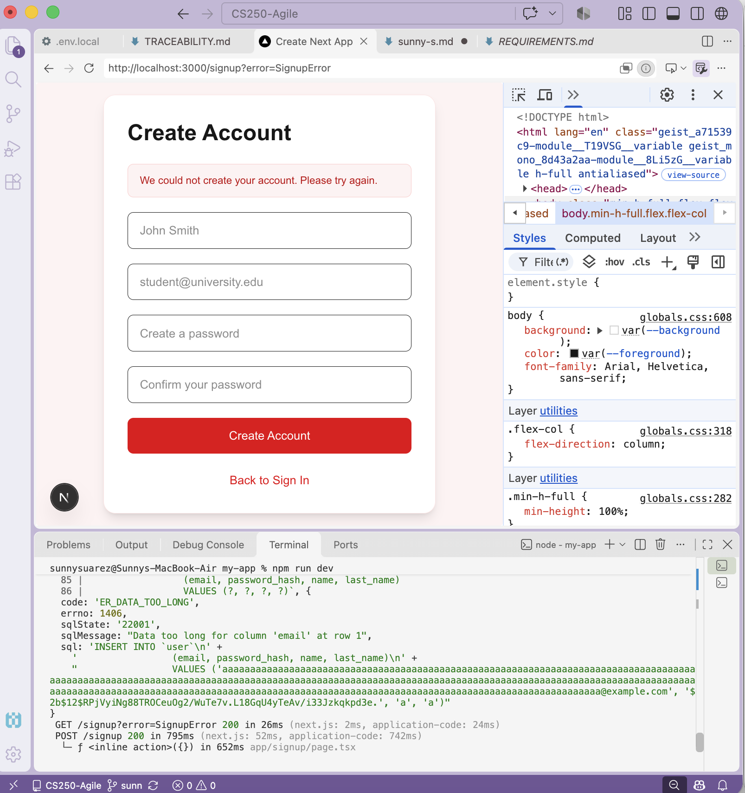

# Sunny Suarez

## Bug Fix 1: Signup with a 300-character email shows a generic error

- **Issue:** https://github.com/NoamGaribi/CS250-Agile/issues/89
- **Pull Request:** https://github.com/NoamGaribi/CS250-Agile/pull/92
- **Files changed:** 'my-app/app/signup/page.tsx'

**Before** (terminal shows 'ER_DATA_TOO_LONG' for column 'email', page shows "We could not create your account. Please try again."):

**After** (page shows "Email must be 255 characters or less." and the terminal shows no database error):

**Code bug or test bug:** Code bug. The test was correct: the terimnal showed MySQL rejecting the insert with 'ER_DATA_TOO_LONG', and 'app/signup/page.tsx' had no length check before the insert, so every over-long email fell into the generic 'SignupError' message.

**What I changed:** Added an 'EmailTooLong' error message and a check that redirects to '/signup?error=EmailTooLong' when the email is longer than 255 characters, before the password is hashed or the database is called.

**Regression check:** Signed up with a normal short and valid email and reached '/dashboard'. 

---

## Bug Fix 2: Signup with a 300-character name shows a generic error

- **Issue:** https://github.com/NoamGaribi/CS250-Agile/issues/92
- **Pull Request:** https://github.com/NoamGaribi/CS250-Agile/pull/93
- **Files changed:** 'my-app/app/signup/page.tsx'

**Before** (terminal shows 'ER_DATA_TOO_LONG' for column 'name', page shows "We could not create your account. Please try again."):

**After** (page shows "Name must be 100 characters or less." and the terminal shows no database error):

**Code bug or test bug:** Code bug. The terminal showed 'ER_DATA_TOO_LONG' for the 'name' column, and the singup code inserted the name without checking its length, the same root cause as Issue 89 in a different field.

**What I changed:** Added an 'NameTooLong' error message and a check that redirects to '/signup?error=NameTooLong' when the name is longer than 100 characters, matching the size of the 'name' column in the 'user' table.

**Regression check:** Signed up with the name 'Test User' and a valid email and reached '/dashboard'.

---

## AI Disclosure

I used Claude to help in finding the bugs as my previous test cases from PR3 all passed; therefore, I was a little stuck in what to fix for this PR4. An inline AI code suggestion in VS Code also proposed the name length check as I was about to write it as well. 