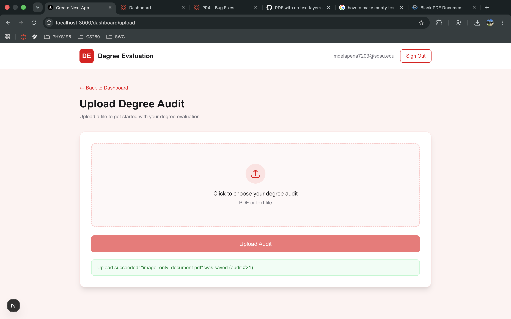
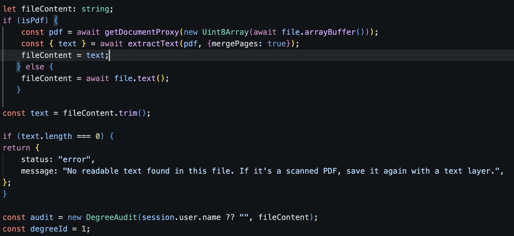
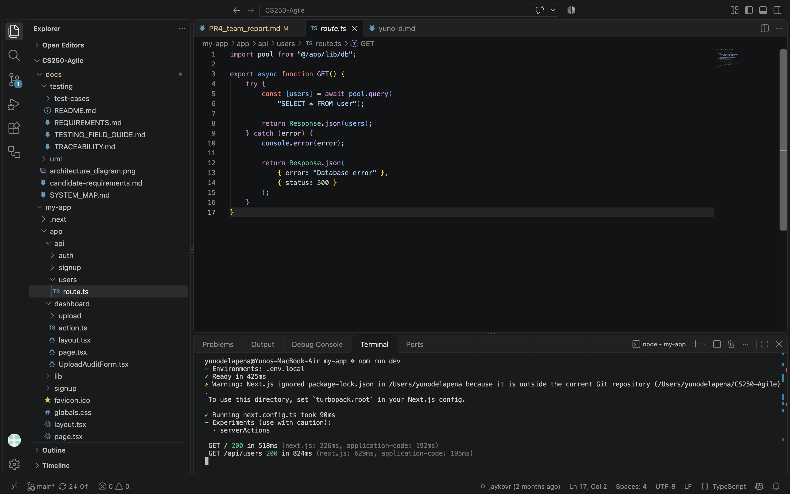
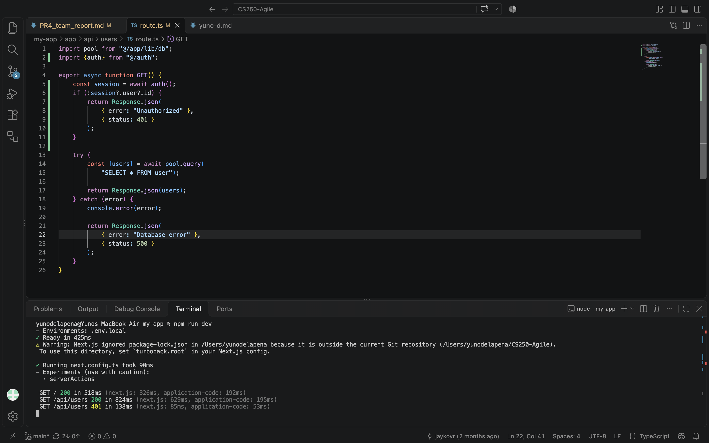

# Yuno Dela Pena

---

**Issue Link:** https://github.com/NoamGaribi/CS250-Agile/issues/101
**Pull Request:** https://github.com/NoamGaribi/CS250-Agile/pull/102

**Before:** 

**After:** 

**Code Bug or Test Bug:** Code Bug | The test was correct, PDFs were allowed to be uploaded, however, PDFs with no text layer would not return anything.

---

**Issue Link:** https://github.com/NoamGaribi/CS250-Agile/issues/104
**Pull Request:** https://github.com/NoamGaribi/CS250-Agile/pull/105

**Before:** 

**After:** 

**Code Bug or Test Bug:** Code Bug | The test was correct, the route did not have an 'auth' check and allowed for signed-out users to see every password hash.

---