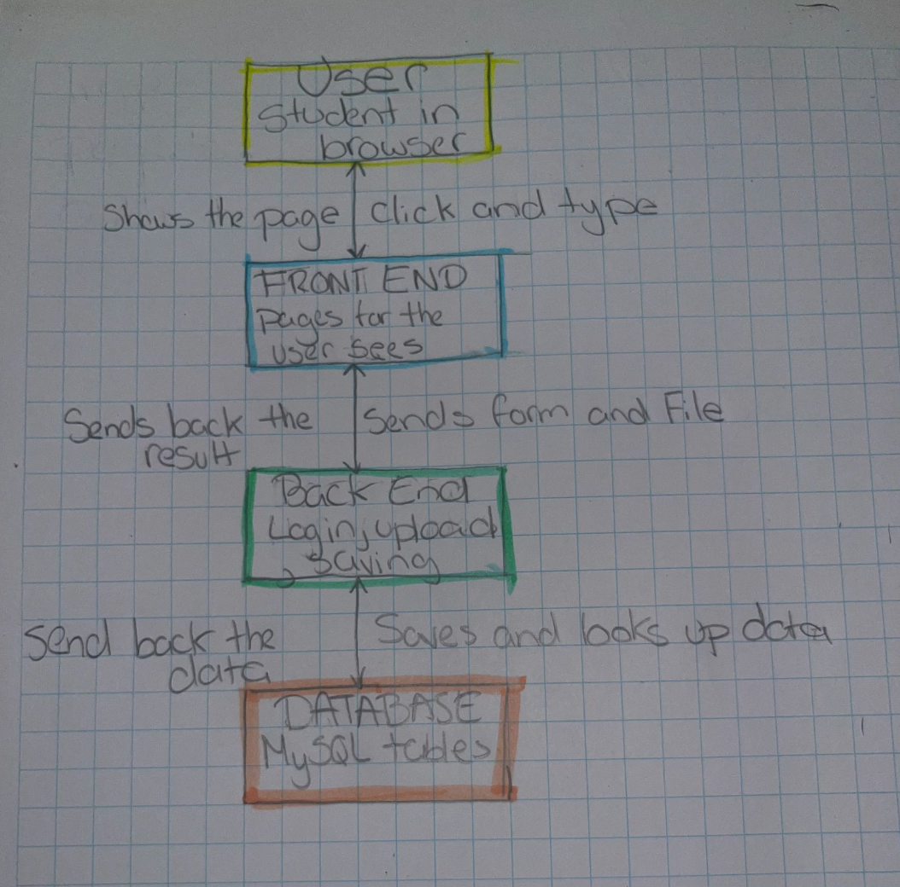

# System Map: SDSU CS Degree Planning Website

**Team:** Degree Planner
**Inherited project:** Noam Garibi's team (github.com/NoamGaribi/CS250-Agile)

| Role | Owns | Name |
|------|------|------|
| Product Analyst | Part 1 and the questions in Part 4 | Sunny Suarez |
| Architect | Part 2 and the mismatches in Part 4 | Alexa Quintero-Iriarte |
| Frontend Tracer | Part 3, client side | Yuno Dela Pena |
| Backend Tracer | Part 3, server side | Jania Little |

---

## Part 1: Purpose

This system lets SDSU students upload their degree audit from my.sdsu so they can plan ahead and see which courses they should take next.

**User action we traced:** A user creates a profile and uploads a degree audit. Users can return and reassess their plan by signing back in.

---

## Part 2: As-built architecture diagram



Text version (every arrow labeled with what travels on it):

```
[Student in browser] --clicks and typing-------------------------> [Front end: Next.js pages]
[Front end]          --page shown to the user--------------------> [Student in browser]
[Front end]          --FormData (form fields + audit file text)--> [Back end: server actions]
[Back end]           --UploadState (status + message)------------> [Front end]
[Back end]           --parameterized SQL (INSERT / SELECT)-------> [Database: MySQL tables]
[Database]           --query results / insertId------------------> [Back end]
```

---

## Part 3: Trace the click

User action: upload a degree audit. Rows 1 and 7 belong to the Frontend Tracer. Rows 2 to 6 belong to the Backend Tracer.

| Step | Layer | File and function | Data in / data out | Notes or surprises |
|------|-------|-------------------|--------------------|--------------------|
| 1 | Frontend | app/dashboard/UploadAuditForm.tsx → handleSubmit(formData) → formAction (from useActionState) | Text in `<input name="file">` → FormData sent to the server | |
| 2 | API route (server action) | app/dashboard/action.ts → uploadAudit(prevState, formData) ("use server") | FormData → file text (string) and session.user.id | Server action, not an /api route |
| 3 | Backend logic | app/lib/DegreeAudit.ts → new DegreeAudit(name, text), then extractRequirements(names) and extractProgress() → extract() | Audit text plus requirement names from the database → ParsedAuditCourse[] (code, status, term, grade) and ParsedAuditRequirement[] (name, status) | |
| 4 | Database (repo) | app/lib/repos/AuditRepository.ts → saveDegreeAudit(userId, degreeId, audit) | userId, degreeId, and DegreeAudit → auditImportId | Repo calls the parse methods |
| 5 | Database (MySQL) | app/lib/db.ts → pool; tables audit_imports, user_courses, audit_requirement_results | SQL inserts with parameters → insertId | Each import is saved with a status |
| 6 | Response back | app/dashboard/action.ts returns UploadState | Out: { status, message } | |
| 7 | Frontend (display) | app/dashboard/UploadAuditForm.tsx → state from useActionState | UploadState → status box | |

**Meeting point:** the server action `uploadAudit()` in `app/dashboard/action.ts`. This app has no /api route for uploads; Next.js sends the form data to this function as a POST request.

---

## Part 4: Reality check and open questions

### What the handoff docs got wrong or left out

1. **Front end:** The UML has no pages, forms, or file upload. It only has classes.
2. **Server action layer:** The UML has Student calling the classes directly, with no server action in between.
3. **Login and repositories:** The UML skips login and the repository layer.
4. **Database:** The UML has no database at all.

### Three questions for the original team

1. **Intent:** Are users meant to be able to upload multiple audits?
2. **Design:** How are user preferences meant to influence the roadmap?
3. **Intent:** Is the import feature meant to accept only PDF and text files?

---

## Part 5: Candidate Requirements

| ID | Candidate Requirement | Type | Source | Status | Acceptance Criterion |
|----|----------------------|------|--------|--------|----------------------|
| CR-1 | The system shall show "Invalid email or password." when a login attempt fails. | Functional | auth.ts → authorize() (returns null on bad password); app/page.tsx | Confirmed | Enter an existing account's email with a wrong password; page reloads at /?error=CredentialsSignin and shows "Invalid email or password." |
| CR-2 | The system shall store each password only as a bcrypt hash. | Non-functional (Security) | app/signup/page.tsx server action (bcrypt.hash); user.password_hash column | Confirmed | Sign up with password "Password!". In the user table, password_hash starts with $2b$12$ and does not equal "Password!". |
| CR-3 | The system shall redirect unauthenticated visitors from /dashboard to the login page. | Functional | app/dashboard/page.tsx (if (!session) redirect("/")) | Confirmed | While signed out, navigate to localhost:3000/dashboard. Browser redirects to / and displays the login form. |
| CR-4 | The system shall reject audit file uploads larger than 5MB. | Non-functional (Constraint) | Not in code. Trace row 2 (app/dashboard/action.ts) has no file size check. | Unconfirmed | Upload an audit file of size 5.1MB; server returns error message "File size exceeds 5MB limit." |
| CR-5 | The system shall accept only PDF or text files on the audit upload form. | Functional | Trace row 2 (app/dashboard/action.ts accepts any string body without checking file extension) | Suspected bug | Upload a .png or .exe file; server returns 400 error stating "Invalid file type." |
| CR-6 | The system shall list a course as completed only when its grade is passing. | Functional | DegreeAudit.extractProgress() in app/lib/DegreeAudit.ts | Suspected bug | Parse the audit line "FA21 CS 150 3.0 F"; getCompletedCourseCodes() returns [] (a "B" line returns ["CS 150"]). |
| CR-7 | The system shall recognize course subjects of up to 5 letters. | Functional | DegreeAudit.extractProgress() in app/lib/DegreeAudit.ts | Unconfirmed | Parse the audit line "FA21 ABCDE 101 3.0 A"; getCompletedCourseCodes() returns ["ABCDE 101"]. |

---

## Part 6: Three Unit Test Cases

| Test ID | Requirement ID | Unit Under Test | Input | Expected Output | Test Kind | Predicted Result Today |
|---------|----------------|-----------------|-------|-----------------|-----------|------------------------|
| TC-1 | CR-6 | app/lib/DegreeAudit.ts → DegreeAudit.extractProgress() | "FA21 CS 150 3.0 B" | p.getCompletedCourseCodes() → ["CS 150"]; audit.getParsedCourses() → [{ courseCode: "CS 150", status: "completed", termLabel: "FA21", grade: "B" }] | Positive | Pass |
| TC-2 | CR-6 | app/lib/DegreeAudit.ts → DegreeAudit.extractProgress() | "FA21 CS 150 3.0 F" | p.getCompletedCourseCodes() → [] | Negative | Fail (any grade, including F, is marked as completed) |
| TC-3 | CR-7 | app/lib/DegreeAudit.ts → DegreeAudit.extractProgress() | "FA21 ABCDE 101 3.0 A" | p.getCompletedCourseCodes() → ["ABCDE 101"] | Boundary | Pass (5 letters is the limit) |